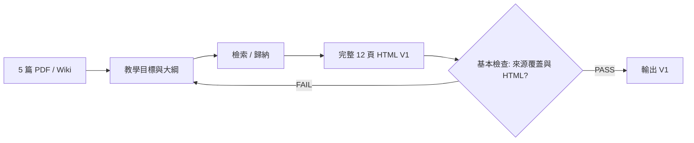
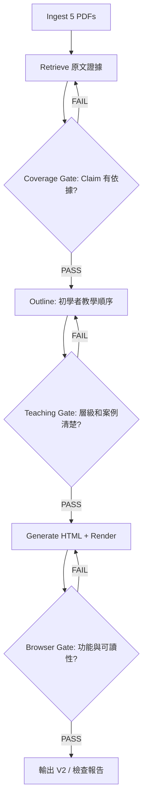

# 本次採用 Graph（內含 Loop / 失敗回路）

請參考公開網站 `docs/workflow.html`，包含兩版完整圖、State 與修改原因。Graph 一種圖即可，帶條件返回箭頭就是 Loop。

## V1 Graph

## V2 Graph

## 實作限制

本次是 AI 協助整理、人工編排與 Python/Browser 的確定性檢查流程，沒有實際部署 LLM Agent 模型呼叫 API。
